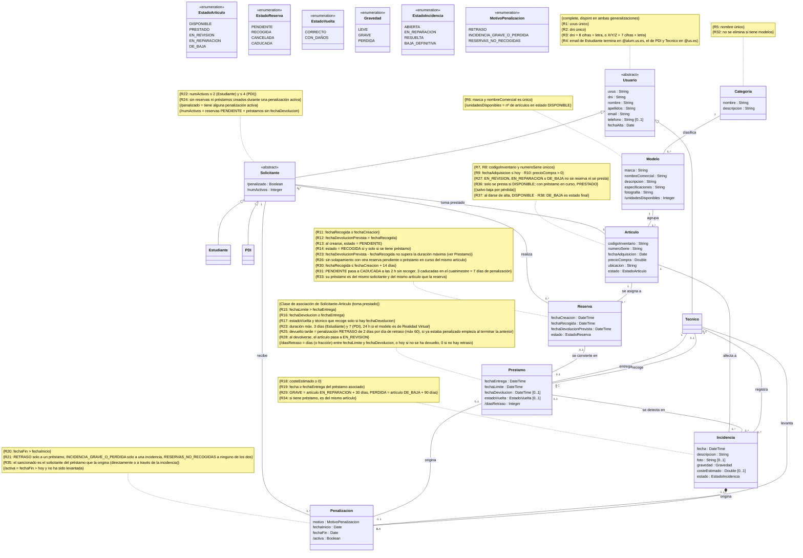
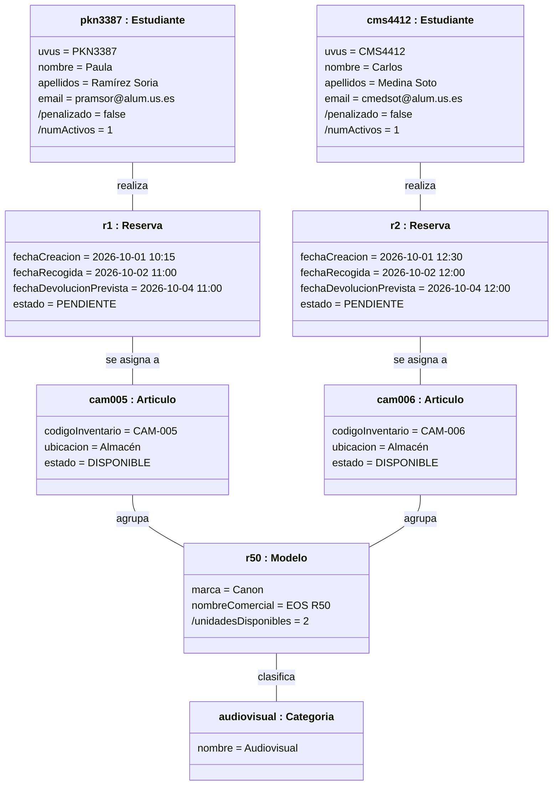
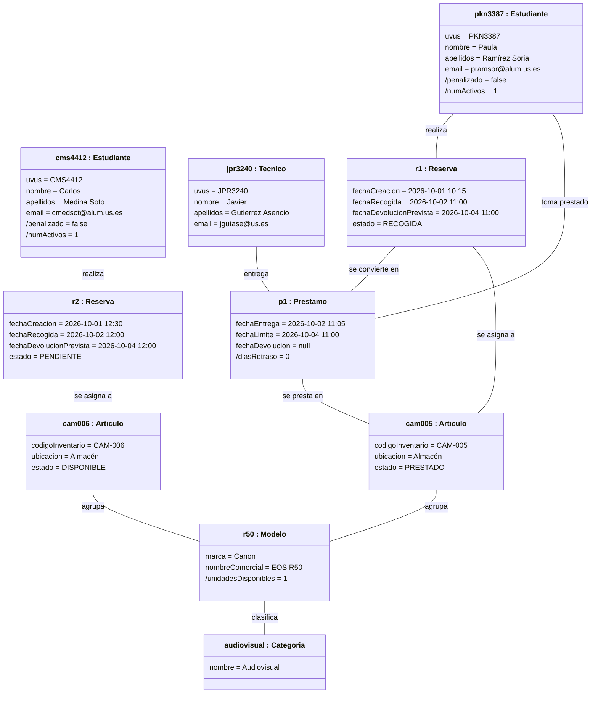
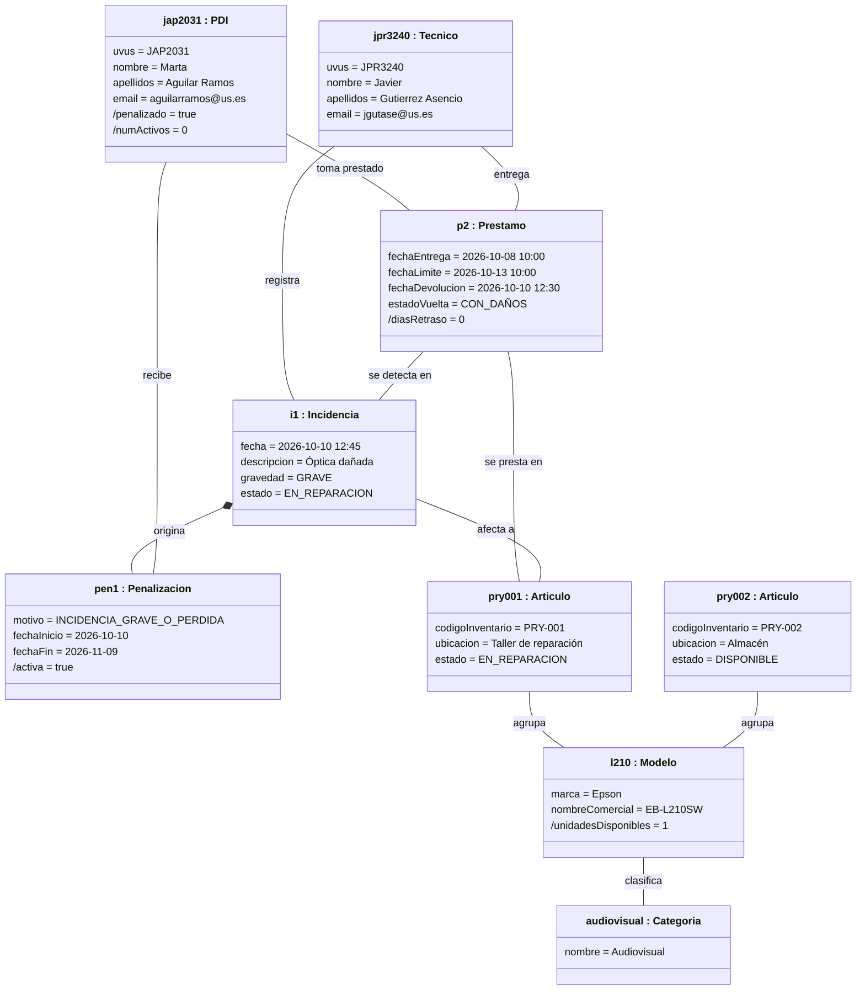

# EquipaUS

Sistema de gestión del préstamo de material de la Escuela (portátiles, cámaras, gafas de realidad virtual, kits de electrónica y otros equipos).

## Miembros del grupo L5-AM-7

1. Robles Pérez, Javier
2. Rodríguez Gallego, Eloy
3. Martínez Adega, Nicolás
4. García Martínez, Daniel

---

## 1. Introducción al problema

EquipaUS sustituye el cuaderno de papel y la hoja de cálculo con los que hoy se prestan portátiles, cámaras, gafas de realidad virtual y kits de electrónica en la Escuela por un sistema que sabe en todo momento qué equipo tiene cada persona, hasta cuándo lo tiene y en qué estado se encuentra.

### 1.1. Usuarios

El sistema lo utilizan los estudiantes y el profesorado (PDI) de la Escuela, que son quienes piden material, y los técnicos del servicio de préstamo, que lo entregan, lo recogen y mantienen el inventario. La descripción detallada de cada tipo de usuario se encuentra en el apartado 3.2.

### 1.2. Situación actual

Actualmente el préstamo funciona de forma manual. El estudiante se acerca al mostrador y el técnico consulta una hoja de Excel compartida para comprobar si queda algún equipo libre. Si lo hay, apunta a mano en un cuaderno el nombre, el DNI, el equipo prestado y la fecha prevista de devolución, y entrega el material. Si alguien quiere asegurarse un equipo para otro día, tiene que pedirlo por correo electrónico, y el técnico lo anota, si se acuerda, en la misma hoja de cálculo.

### 1.3. Problemas detectados

**Falta de trazabilidad.** Como el registro está en papel, no es posible saber quién tuvo un equipo antes de que apareciera dañado. Por ejemplo, una cámara puede aparecer con la lente rayada sin que nadie sepa quién fue el último en usarla, por lo que el daño queda sin responsable.

**Dobles reservas.** La hoja de cálculo no se actualiza en tiempo real, de modo que dos grupos pueden contar con el mismo proyector para su defensa de TFG el mismo día. Esto genera conflictos y obliga a retrasar defensas.

**Retrasos sin consecuencias.** No existe ningún mecanismo que sancione a quien devuelve tarde. Un portátil puede devolverse con tres semanas de retraso sin que pase nada, mientras otros estudiantes se quedan sin equipo.

**Equipos averiados en circulación.** Cuando un equipo se devuelve roto no queda marcado de ninguna forma, por lo que puede volver a prestarse. Por ejemplo, unas gafas de realidad virtual con el cable roto pueden entregarse a otro estudiante, lo que empeora la imagen del servicio y provoca más averías.

**Ausencia de datos para tomar decisiones.** No se sabe qué equipos tienen más demanda ni cuáles no se usan nunca, por lo que el servicio puede acabar comprando material que nadie pide.

---

## 2. Glosario de términos

| Término | Definición |
| --- | --- |
| **Artículo** | Unidad física concreta de un modelo: el objeto que el técnico entrega en el mostrador y que el solicitante se lleva. Se identifica por su número de serie y por su código de inventario, una etiqueta con código de barras que se escanea en el mostrador. Es lo único que se reserva, se presta, se devuelve y se puede romper. Ejemplo: VR-002, una de las tres gafas Meta Quest 3 del servicio. |
| **Catálogo** | Escaparate de todo lo que el servicio ofrece: es lo que el solicitante consulta para decidir qué pedir. Muestra modelos, no unidades, e indica cuántas unidades libres hay de cada uno. El catálogo no se presta; solo se consulta. |
| **Categoría** | Clasificación que ordena el catálogo por temas para que sea fácil encontrar lo que se busca: Informática, Audiovisual, Realidad Virtual, Electrónica y Robótica, y Accesorios. Solo sirve para agrupar modelos; nunca se reserva ni se presta una categoría. Ejemplo: la categoría Realidad Virtual agrupa los modelos Meta Quest 3 y HTC Vive XR Elite. |
| **Devolución** | Acto que pone fin a un préstamo: el solicitante entrega el artículo en el mostrador y el técnico anota la fecha y hora reales y si el material vuelve correcto o con daños. Si la devolución llega después de la fecha límite, se genera una penalización. |
| **Estado del artículo** | Situación en la que se encuentra un artículo en cada momento y que decide si puede entregarse o no: Disponible, Prestado, En revisión, En reparación o De baja (ver apartado 2.1). |
| **Incidencia** | Registro de un daño, avería o pérdida que afecta a un **artículo**. Tiene una gravedad (Leve, Grave o Pérdida) y determina si el artículo puede seguir prestándose. |
| **Modelo** | Tipo de equipo, con su marca, nombre comercial, descripción, especificaciones y fotografía. Es lo que el solicitante elige en el catálogo, pero no lo que se lleva: el sistema le asigna uno de los artículos de ese modelo. Ejemplo: el modelo Meta Quest 3, del que el servicio tiene tres artículos. |
| **PDI** | Personal Docente e Investigador: el profesorado y los investigadores de la universidad. En EquipaUS pide material para impartir clases y prácticas, por lo que suele necesitarlo varios días seguidos y a veces varias unidades a la vez. |
| **Penalización** | Sanción que recae sobre un **solicitante** y le impide reservar o llevarse material durante un tiempo. Se genera por devolver tarde, por una incidencia grave o una pérdida, o por no recoger varias reservas. |
| **Préstamo** | Periodo en el que el solicitante tiene el artículo en su poder y es responsable de él. Empieza en el mostrador, cuando el técnico le entrega el artículo, y termina con la devolución. Tiene una fecha límite de devolución, que se calcula al empezar. |
| **Reserva** | Compromiso que el solicitante hace por adelantado, desde la aplicación, para recoger un artículo en una fecha y hora futuras. Mientras es una reserva, el solicitante todavía no tiene nada en la mano: solo tiene la garantía de que ese artículo estará libre para él en ese periodo. La reserva termina de una de tres formas: el solicitante la recoge y se convierte en préstamo, la cancela, o no se presenta a tiempo y caduca. |
| **Solicitante** | Nombre común para los usuarios que piden material: estudiantes y PDI. |
| **Técnico** | Personal del servicio de préstamo. Atiende el mostrador, entrega y recoge los artículos, registra las incidencias, mantiene el catálogo y el inventario, y revisa las penalizaciones. |
| **UVUS** | Usuario Virtual de la Universidad de Sevilla: identificador único con el que cada miembro de la universidad inicia sesión. |

### 2.1. Ciclo de vida del artículo

Cada artículo pasa por distintos estados a lo largo de su vida útil, y el estado determina si se puede prestar o no.

Cuando un artículo se da de alta en el sistema queda en estado **Disponible**, que es el único estado desde el que puede entregarse. Cuando el técnico lo entrega a un solicitante, pasa a **Prestado**.

Al devolverse, el artículo no vuelve directamente a Disponible, sino que pasa a **En revisión**, para que el técnico compruebe que funciona correctamente antes de prestarlo de nuevo (regla RN06). Si la revisión es correcta, el técnico lo pasa a Disponible.

Si durante la revisión se detecta un daño grave, se registra una incidencia y el artículo pasa a **En reparación** (regla RN07). Cuando se repara, vuelve a Disponible. Si no tiene arreglo, pasa a **De baja**, que es un estado final: el artículo ya no puede volver a prestarse, pero se conserva en el sistema para mantener su historial.

Por último, si un solicitante pierde un artículo mientras lo tiene prestado, este pasa directamente de Prestado a De baja (regla RN07).

Una reserva no cambia el estado del artículo, porque mientras alguien tiene una reserva el artículo sigue en el servicio y puede estar prestado a otra persona hasta la fecha de recogida. Por ejemplo, un portátil puede estar Prestado esta semana y tener ya una reserva para la siguiente. Por eso las reservas se controlan por sus fechas (regla RN05) y no por el estado.

---

## 3. Visión general del sistema

### 3.1. Requisitos generales

El sistema debe cubrir cinco áreas de funcionamiento.

La **gestión de usuarios** registra a estudiantes, PDI y técnicos con sus datos personales, su tipo de usuario y si están o no penalizados.

La **gestión del catálogo y del inventario** permite dar de alta, modificar y dar de baja categorías, modelos y artículos, y conocer el estado de cada artículo.

La **gestión de reservas y préstamos** cubre el recorrido completo del material, que tiene tres momentos. Primero, desde la aplicación y con antelación, el solicitante hace una **reserva**: elige un modelo y unas fechas, y el sistema le asigna un artículo libre para ese periodo. Después, el día indicado, acude al mostrador y el técnico le entrega el artículo: en ese momento la reserva se da por recogida y empieza el **préstamo**. Por último, el solicitante devuelve el artículo y el técnico registra la **devolución**, que cierra el préstamo. También puede hacerse un préstamo directamente en el mostrador, sin reserva previa, si hay un artículo libre en ese momento.

La **gestión de incidencias y penalizaciones** registra los daños y pérdidas de los artículos y las sanciones de los solicitantes que incumplen las normas.

Las **consultas y estadísticas** ofrecen a cada usuario los listados que necesita: al solicitante, sus reservas, sus préstamos y su historial; al técnico, el trabajo diario del mostrador y los datos de uso del servicio.

### 3.2. Usuarios del sistema

**Estudiante.** Es el alumnado de grado y máster de la Escuela y el grupo que más material pide, sobre todo para prácticas y para el TFG o TFM. Puede consultar el catálogo y la disponibilidad, hacer reservas y consultar sus reservas, sus préstamos, su historial y sus penalizaciones. Como es el grupo más numeroso, tiene las condiciones más restrictivas para que el material rote entre todos: como máximo 2 reservas o préstamos activos y 3 días por préstamo.

**PDI.** Es el profesorado de la Escuela. Pide material para impartir clases y prácticas, lo que exige tenerlo durante varias sesiones a lo largo de una semana y, a menudo, varios equipos a la vez para un mismo grupo de alumnos. Puede hacer las mismas consultas y reservas que un estudiante, pero con condiciones adaptadas a ese uso: como máximo 4 reservas o préstamos activos y 7 días por préstamo.

**Técnico.** Es el personal del servicio de préstamo que atiende el mostrador. No pide material, sino que lo gestiona: entrega y recoge los artículos, registra las incidencias, cambia el estado de los artículos, mantiene el catálogo y el inventario, reclama los préstamos vencidos, revisa las penalizaciones y consulta las estadísticas de uso.

---

## 4. Catálogo de requisitos

### 4.1. Mapa de historias de usuario

Los requisitos funcionales se organizan en cuatro actividades, según el usuario que las realiza.

**Explorar el catálogo (solicitante).** Agrupa las consultas que el solicitante hace antes de pedir material: consultar el catálogo por categorías (RF01) y consultar la disponibilidad de un modelo en unas fechas (RF02).

**Seguir mi actividad (solicitante).** Agrupa las consultas sobre el propio solicitante, siguiendo el recorrido del material: lo que va a recoger, es decir, sus reservas pendientes (RF03); lo que tiene ahora, es decir, sus préstamos en curso (RF04); lo que ya devolvió, es decir, su historial (RF05); y su situación de penalización (RF06).

**Atender el mostrador (técnico).** Agrupa las consultas del trabajo diario en el mostrador: préstamos vencidos (RF07), agenda del día (RF08), historial de un artículo (RF09) y artículos fuera de servicio (RF10).

**Supervisar el servicio (técnico).** Agrupa las consultas para revisar y planificar el servicio: solicitantes penalizados (RF11), modelos más demandados (RF12) e inventario por estado y categoría (RF13).

### 4.2. Requisitos de información

#### RI01. Información de usuarios

Como **técnico** quiero almacenar el UVUS, DNI o NIE, nombre, apellidos, correo institucional, teléfono, tipo de usuario (estudiante, PDI o técnico) y fecha de alta de cada usuario, para identificar a quién se presta cada equipo y poder contactarle.

El UVUS y el DNI o NIE son únicos. El DNI debe tener 8 cifras y una letra, y el NIE una letra X, Y o Z seguida de 7 cifras y una letra. El correo de los estudiantes debe terminar en @alum.us.es, y el del PDI y los técnicos en @us.es. Todos los datos son obligatorios salvo el teléfono.

#### RI02. Información de categorías y modelos

Como **técnico** quiero almacenar las categorías (nombre y descripción) y, de cada modelo, su marca, nombre comercial, descripción, especificaciones técnicas, fotografía y categoría, para mostrar un catálogo claro a los solicitantes.

No pueden existir dos categorías con el mismo nombre ni dos modelos con la misma marca y nombre comercial. Todo modelo pertenece obligatoriamente a una única categoría, y no puede eliminarse una categoría que tenga modelos asociados.

#### RI03. Información de artículos

Como **técnico** quiero almacenar de cada artículo su código de inventario, número de serie, modelo, fecha de adquisición, precio de compra, ubicación y estado, para saber exactamente qué equipo es y dónde está.

El código de inventario y el número de serie son únicos. La fecha de adquisición no puede ser posterior a la fecha actual y el precio de compra debe ser mayor que 0. El estado solo puede ser Disponible, Prestado, En revisión, En reparación o De baja, y todo artículo pertenece obligatoriamente a un modelo. Todo artículo se da de alta en estado Disponible y, una vez De baja, ya no puede cambiar de estado (apartado 2.1).

#### RI04. Información de reservas

Como **solicitante** quiero que se guarde de cada reserva quién la hace, qué artículo se le asigna, cuándo se creó, la fecha y hora en que va a recogerlo, la fecha y hora en que prevé devolverlo, y su estado, para asegurarme el material que necesito en una fecha concreta.

La fecha de recogida no puede ser anterior a la fecha de creación y la fecha prevista de devolución debe ser posterior a la de recogida. El estado solo puede ser Pendiente, Recogida, Cancelada o Caducada, y toda reserva nueva se crea como Pendiente.

#### RI05. Información de préstamos

Como **técnico** quiero almacenar de cada préstamo el solicitante, el artículo, la reserva de la que procede (si existe), el técnico que lo entrega, la fecha y hora de entrega, la fecha límite de devolución, la fecha y hora de devolución real, el técnico que lo recoge y el estado en que vuelve el material (Correcto o Con daños), para tener la trazabilidad completa de cada equipo.

La fecha límite debe ser posterior a la de entrega y la fecha de devolución real, si existe, no puede ser anterior a la de entrega. Mientras no haya devolución, el préstamo se considera en curso, y el técnico que recoge y el estado de vuelta solo pueden registrarse cuando haya devolución.

#### RI06. Información de incidencias

Como **técnico** quiero almacenar de cada incidencia el artículo afectado, el préstamo en que se detectó (si existe), el técnico que la registra, la fecha, una descripción, una foto opcional del daño, la gravedad, el coste estimado de reparación y su estado, para controlar las averías y saber quién es responsable.

La gravedad solo puede ser Leve, Grave o Pérdida, y el estado Abierta, En reparación, Resuelta o Baja definitiva. El coste estimado, si se indica, debe ser mayor o igual que 0, y la fecha de la incidencia no puede ser anterior a la entrega del préstamo asociado.

#### RI07. Información de penalizaciones

Como **técnico** quiero almacenar de cada penalización el solicitante, el motivo, el préstamo o la incidencia que la originó, la fecha de inicio, la fecha de fin y, si se levantó manualmente, qué técnico lo hizo, para aplicar las sanciones de forma justa y poder revisarlas.

El motivo solo puede ser Retraso, Incidencia grave o pérdida, o Reservas no recogidas. La fecha de fin debe ser posterior a la de inicio. Toda penalización por retraso o por incidencia debe estar asociada al préstamo o a la incidencia que la causó.

### 4.3. Reglas de negocio

#### RN01. Máximo de reservas y préstamos simultáneos

Un solicitante no puede superar un número máximo de reservas pendientes y préstamos en curso sumados: 2 en el caso de los estudiantes y 4 en el del PDI. Las reservas cuentan aunque el solicitante todavía no tenga el material, porque ya ocupan un artículo. Si se intenta superar el límite, la reserva se rechaza con el mensaje «Has alcanzado el máximo de N reservas y préstamos activos».

**Prueba de aceptación**

- **Situación inicial:** la estudiante Lucía tiene un portátil prestado y una reserva pendiente de una cámara para el viernes.
- **Acción:** intenta reservar un kit Arduino.
- **Resultado esperado:** la reserva se rechaza con el mensaje «Has alcanzado el máximo de 2 reservas y préstamos activos».

#### RN02. Duración máxima del préstamo

La fecha límite de devolución no puede superar, desde la entrega, 3 días naturales para los estudiantes y 7 días para el PDI. Los modelos de la categoría Realidad Virtual tienen un máximo de 24 horas para cualquier solicitante, debido a su alta demanda.

**Prueba de aceptación**

- **Situación inicial:** un profesor (PDI) va a reservar unas gafas Meta Quest 3.
- **Acción:** indica que las devolverá 48 horas después de recogerlas.
- **Resultado esperado:** la reserva se rechaza porque la duración máxima para los modelos de Realidad Virtual es de 24 horas, aunque el PDI tenga hasta 7 días para el resto del material.

#### RN03. Bloqueo por penalización activa

Un solicitante con una penalización cuya fecha de fin aún no ha llegado no puede hacer reservas ni recoger material. Sí puede devolver lo que tenga prestado y consultar sus datos.

**Prueba de aceptación**

- **Situación inicial:** Pablo tiene una penalización activa hasta el 30 de octubre.
- **Acción:** el 25 de octubre intenta reservar una cámara.
- **Resultado esperado:** la reserva se rechaza y se le indica que está penalizado hasta el 30 de octubre.

#### RN04. Penalización automática por retraso

Al registrar una devolución posterior a la fecha límite se genera automáticamente una penalización de 2 días por cada día (o fracción de día) de retraso, con un máximo de 60 días. Si el solicitante ya estaba penalizado, la nueva penalización empieza cuando termine la anterior.

**Prueba de aceptación**

- **Situación inicial:** un portátil tenía como fecha límite de devolución el 20 de octubre a las 14:00.
- **Acción:** se devuelve el 23 de octubre a las 10:00, con un retraso de 2 días y 20 horas, que cuenta como 3 días.
- **Resultado esperado:** el sistema crea automáticamente una penalización de 6 días.

#### RN05. Sin solapamiento sobre un mismo artículo

Un artículo no puede tener dos reservas pendientes o préstamos en curso cuyos periodos se solapen, aunque sea un minuto. Si dos solicitantes intentan reservar el mismo artículo a la vez, solo una de las dos reservas se confirma.

**Prueba de aceptación**

- **Situación inicial:** el proyector PRY-004 está reservado del 20 al 22 de octubre.
- **Acción:** otro solicitante intenta reservar el proyector PRY-004 del 21 al 23 de octubre.
- **Resultado esperado:** la reserva se rechaza para ese artículo, aunque el resto de proyectores libres siguen disponibles.

#### RN06. Solo se prestan artículos operativos

Un artículo en estado En revisión, En reparación o De baja no puede asignarse a ninguna reserva ni entregarse en préstamo. Toda devolución deja el artículo En revisión hasta que un técnico lo comprueba y lo pasa a Disponible.

**Prueba de aceptación**

- **Situación inicial:** la cámara CAM-002 está En reparación.
- **Acción:** un técnico intenta entregarla en préstamo en el mostrador.
- **Resultado esperado:** el préstamo se rechaza y la cámara no se cuenta como disponible en el catálogo.

#### RN07. Consecuencias de una incidencia grave o una pérdida

Al registrar una incidencia de gravedad Grave, el artículo pasa automáticamente a En reparación y el solicitante responsable recibe una penalización de 30 días. Si la gravedad es Pérdida, el artículo pasa a De baja y la penalización es de 90 días.

**Prueba de aceptación**

- **Situación inicial:** unas gafas de realidad virtual se devuelven con la lente rota.
- **Acción:** el técnico registra una incidencia de gravedad Grave.
- **Resultado esperado:** las gafas pasan a En reparación y el solicitante recibe una penalización de 30 días.

#### RN08. Antelación máxima de las reservas

No se puede reservar con más de 14 días de antelación, para evitar que los equipos queden bloqueados durante semanas por reservas hechas «por si acaso».

**Prueba de aceptación**

- **Situación inicial:** hoy es 8 de octubre.
- **Acción:** un solicitante intenta reservar un portátil para recogerlo el 30 de octubre.
- **Resultado esperado:** la reserva se rechaza, ya que solo se admiten reservas con recogida hasta el 22 de octubre.

#### RN09. Caducidad de reservas no recogidas

Una reserva que no se recoge en las 2 horas siguientes a su hora de recogida pasa a Caducada, nunca llega a ser préstamo y el artículo queda libre para otros. Si un solicitante acumula 3 reservas caducadas en el mismo cuatrimestre, recibe una penalización de 7 días.

**Prueba de aceptación**

- **Situación inicial:** Ana tiene 2 reservas caducadas en el cuatrimestre actual.
- **Acción:** no recoge una tercera reserva en las 2 horas siguientes a su hora de recogida.
- **Resultado esperado:** la reserva pasa a Caducada y Ana recibe una penalización de 7 días.

### 4.4. Requisitos funcionales

En este entregable solo se recogen requisitos funcionales de **listado y consulta**. Cada uno indica las reglas de negocio (apartado 4.3) que le afectan.

#### RF01. Consultar el catálogo por categorías

Como **solicitante** quiero ver todos los modelos del catálogo agrupados por categoría, con su foto, descripción y número de artículos disponibles, para saber rápidamente qué material puedo pedir.

Los modelos aparecen agrupados por categoría y, dentro de cada una, ordenados alfabéticamente por marca y nombre. No se muestran los modelos cuyos artículos estén todos dados de baja, y el número de artículos disponibles no incluye los que estén en revisión, en reparación o de baja.

**Reglas de negocio aplicables:** RN06.

#### RF02. Consultar la disponibilidad de un modelo en unas fechas

Como **solicitante** quiero indicar un modelo y un periodo de fechas y ver cuántos artículos de ese modelo están libres en ese periodo, para saber si puedo reservarlo antes de planificar mi práctica o mi grabación.

Un artículo no se considera libre si el periodo consultado coincide, aunque sea en parte, con una reserva o un préstamo de ese artículo, ni si se encuentra en un estado no prestable. Si el periodo supera la duración máxima permitida al solicitante o empieza con más de 14 días de antelación, se muestra un aviso en lugar del resultado.

**Reglas de negocio aplicables:** RN02, RN05, RN06 y RN08.

#### RF03. Consultar mis reservas pendientes

Como **solicitante** quiero ver las reservas que he hecho y que todavía no he recogido, con el artículo asignado y el día y la hora en que tengo que ir a recogerlo, para no perder ninguna recogida.

Solo aparecen reservas en estado Pendiente, es decir, material que el solicitante todavía no tiene. Se ordenan por fecha de recogida, de la más próxima a la más lejana, y cada una indica la hora a partir de la cual caducará si no se recoge. Se muestra también cuántas reservas y préstamos activos suma el solicitante frente a su máximo permitido (por ejemplo, «1 de 2»).

**Reglas de negocio aplicables:** RN01, RN08 y RN09.

#### RF04. Consultar el material que tengo prestado

Como **solicitante** quiero ver los artículos que ya he recogido y todavía no he devuelto, con su fecha límite de devolución, para saber qué tengo que devolver y cuándo.

Solo aparecen préstamos en curso, es decir, artículos que el solicitante tiene en su poder en este momento. Se ordenan por fecha límite, de la más próxima a la más lejana, y los que ya han superado la fecha límite aparecen marcados como «Vencido» junto con los días de retraso y la penalización que generarán.

**Reglas de negocio aplicables:** RN01, RN02 y RN04.

#### RF05. Consultar mi historial de préstamos

Como **solicitante** quiero consultar los préstamos que ya he devuelto, para saber qué equipos he usado y si alguno lo devolví con retraso o con daños.

Solo aparecen préstamos terminados, es decir, con devolución registrada. Se listan del más reciente al más antiguo, con el modelo y las fechas de inicio, límite y devolución real. Los devueltos tarde muestran los días de retraso, y los que tuvieron una incidencia muestran su gravedad. Cada solicitante solo puede ver su propio historial.

#### RF06. Consultar mi situación de penalización

Como **solicitante** quiero saber si estoy penalizado, por qué y hasta cuándo, para entender por qué no puedo reservar y cuándo podré volver a hacerlo.

Si existe una penalización activa se muestra su motivo, el préstamo o la incidencia que la originó y su fecha de fin. Si no hay ninguna activa se indica «Sin penalizaciones» y se muestran las ya cumplidas.

**Reglas de negocio aplicables:** RN03, RN04, RN07 y RN09.

#### RF07. Listar préstamos vencidos

Como **técnico** quiero un listado de los préstamos no devueltos cuya fecha límite ya ha pasado, para reclamar el material a quien lo tiene.

Solo aparecen los préstamos sin devolución registrada y con fecha límite anterior al momento actual. Se ordenan por días de retraso, de mayor a menor, mostrando el nombre, correo y teléfono del solicitante, el artículo y la penalización que se le aplicará.

**Reglas de negocio aplicables:** RN04.

#### RF08. Listar la agenda del mostrador del día

Como **técnico** quiero ver qué reservas se recogen hoy y qué préstamos vencen hoy, para tener preparado el material que voy a entregar y saber qué devoluciones esperar.

El listado se divide en dos partes ordenadas por hora: las **recogidas**, que son reservas que se convertirán en préstamo cuando el solicitante venga, y las **devoluciones**, que son préstamos que deben terminar hoy. Las reservas que han superado su margen de recogida aparecen marcadas como «Caducada».

**Reglas de negocio aplicables:** RN09.

#### RF09. Consultar el historial de un artículo

Como **técnico** quiero consultar, escaneando su código de inventario, todos los préstamos e incidencias de un artículo, para saber quién lo tenía cuando se estropeó.

Se muestra el estado actual del artículo y, del más reciente al más antiguo, todos sus préstamos (con el solicitante y los técnicos que lo entregaron y lo recogieron) y todas sus incidencias. Si el código no existe, se muestra el mensaje «Artículo no encontrado».

#### RF10. Listar artículos fuera de servicio

Como **técnico** quiero listar los artículos en revisión o en reparación junto con la incidencia que los retiró, para hacer seguimiento de las reparaciones pendientes.

Solo aparecen artículos en esos dos estados, ordenados por la antigüedad de la incidencia, mostrando su gravedad y el coste estimado de reparación.

**Reglas de negocio aplicables:** RN06 y RN07.

#### RF11. Listar solicitantes penalizados

Como **técnico** quiero ver los solicitantes con una penalización activa, para revisar casos y atender reclamaciones.

Solo aparecen las penalizaciones cuya fecha de fin es posterior al momento actual, y el listado puede filtrarse por motivo: retraso, incidencia grave o pérdida, o reservas no recogidas.

**Reglas de negocio aplicables:** RN03.

#### RF12. Consultar el ranking de modelos más demandados

Como **técnico** quiero ver los 10 modelos con más préstamos del curso académico actual y su porcentaje de ocupación, para justificar la compra de nuevos artículos.

El curso académico se considera del 1 de septiembre al 31 de agosto. Se cuentan los préstamos de todos los artículos de cada modelo; las reservas canceladas o caducadas no cuentan, porque nunca llegaron a ser préstamos. En caso de empate, los modelos se ordenan alfabéticamente.

#### RF13. Consultar el inventario por estado y categoría

Como **técnico** quiero un resumen del número de artículos de cada categoría en cada estado y su valor de compra total, para conocer el estado real del material del servicio.

La suma de todos los artículos del resumen coincide con el total de artículos registrados. Los artículos dados de baja se muestran por separado y no suman al valor del inventario activo.

### 4.5. Requisitos no funcionales

#### RNF01. Tiempo de respuesta

Como **solicitante** quiero que el catálogo y la disponibilidad (RF01 y RF02) se muestren en menos de 2 segundos, para poder consultarlos desde el móvil entre clases.

#### RNF02. Protección de datos personales

Como **técnico** quiero que los datos personales de los usuarios (DNI y teléfono) solo sean visibles para el personal del servicio y se traten conforme al RGPD, para cumplir la normativa de la universidad.

#### RNF03. Acceso con la cuenta universitaria

Como **usuario** quiero iniciar sesión con mi UVUS, sin crear otra contraseña, para no tener que recordar una cuenta más.

#### RNF04. Uso desde el móvil

Como **solicitante** quiero que la aplicación se adapte a la pantalla del móvil, para poder reservar desde cualquier sitio.

---

## 5. Modelo conceptual

### 5.1. Diagrama de clases UML

#### 5.1.1. Decisiones de diseño

**Herencia de usuarios.** Usuario es una clase abstracta de la que heredan Solicitante, también abstracta, y Tecnico; de Solicitante heredan Estudiante y PDI. Ambas generalizaciones son completas y disjuntas: todo usuario pertenece exactamente a una de las clases hijas. Se ha elegido esta opción porque el técnico no pide material, por lo que no puede tener reservas, préstamos ni penalizaciones, y porque el estudiante y el PDI tienen límites distintos de préstamos y de duración (RN01 y RN02). Por ello, el tipo de usuario del RI01 no aparece como atributo, sino que lo determina la clase a la que pertenece cada objeto.

**Reserva y Préstamo.** Son clases distintas porque representan momentos distintos: la reserva es un compromiso para recoger un artículo en el futuro y el préstamo es el periodo en que el solicitante tiene el artículo en su poder. Se relacionan con multiplicidad 0..1 en ambos extremos, porque una reserva puede cancelarse o caducar sin llegar a ser préstamo, y un préstamo puede hacerse en el mostrador sin reserva previa.

**Asociación de muchos a muchos.** Un solicitante puede tomar prestados muchos artículos a lo largo del tiempo y un artículo puede prestarse a muchos solicitantes, por lo que Solicitante y Articulo se relacionan con multiplicidad 0..* en ambos extremos. Los datos de cada vez que se produce esa relación (fechas, técnicos que entregan y recogen, estado de vuelta) pertenecen a la asociación y no a ninguno de los dos extremos, así que se guardan en la clase de asociación Prestamo. Por eso en los diagramas de objetos cada préstamo se enlaza con su solicitante y con su artículo.

**Composición entre Incidencia y Penalizacion.** La penalización por incidencia grave o pérdida no tiene sentido sin la incidencia que la origina: nace al registrarla (R29) y desaparece si la incidencia se elimina. Por eso se modela como composición, con el rombo en Incidencia. La multiplicidad en el extremo del todo es 0..1 porque las penalizaciones por retraso y por reservas no recogidas existen sin incidencia (R21).

**Catálogo.** No se representa como una clase porque es único y consiste en el conjunto de todos los modelos agrupados por categoría.

#### 5.1.2. Reglas de derivación

- **/penalizado (Solicitante):** es verdadero si el solicitante tiene alguna penalización activa.
- **/numActivos (Solicitante):** número de reservas en estado PENDIENTE más número de préstamos sin fecha de devolución del solicitante.
- **/unidadesDisponibles (Modelo):** número de artículos del modelo en estado DISPONIBLE.
- **/diasRetraso (Prestamo):** días, contando cada fracción como un día completo, entre la fecha límite y la fecha de devolución o, si no se ha devuelto, la fecha actual. Vale 0 si no hay retraso.
- **/activa (Penalizacion):** es verdadero si la fecha de fin es posterior a la fecha actual y la penalización no ha sido levantada por un técnico (es decir, no está enlazada con ningún técnico mediante «levanta»).

#### 5.1.3. Restricciones

- **R1 (RI01).** El uvus de un usuario es único.
- **R2 (RI01).** El dni de un usuario es único.
- **R3 (RI01).** El dni está formado por 8 cifras y una letra, o por una letra X, Y o Z seguida de 7 cifras y una letra.
- **R4 (RI01).** El email de un estudiante termina en @alum.us.es, y el de un PDI o un técnico en @us.es.
- **R5 (RI02).** El nombre de una categoría es único.
- **R6 (RI02).** No pueden existir dos modelos con la misma marca y el mismo nombre comercial.
- **R7 (RI03).** El código de inventario de un artículo es único.
- **R8 (RI03).** El número de serie de un artículo es único.
- **R9 (RI03).** La fecha de adquisición de un artículo no es posterior a la fecha actual.
- **R10 (RI03).** El precio de compra de un artículo es mayor que 0.
- **R11 (RI04).** La fecha de recogida de una reserva no es anterior a su fecha de creación.
- **R12 (RI04).** La fecha prevista de devolución de una reserva es posterior a su fecha de recogida.
- **R13 (RI04).** Toda reserva nueva se crea en estado PENDIENTE.
- **R14 (RI04, RI05).** Una reserva está en estado RECOGIDA si y solo si tiene un préstamo asociado.
- **R15 (RI05).** La fecha límite de un préstamo es posterior a su fecha de entrega.
- **R16 (RI05).** La fecha de devolución de un préstamo, si existe, no es anterior a su fecha de entrega.
- **R17 (RI05).** Un préstamo tiene estado de vuelta y técnico que lo recoge si y solo si tiene fecha de devolución.
- **R18 (RI06).** El coste estimado de una incidencia, si existe, es mayor o igual que 0.
- **R19 (RI06).** La fecha de una incidencia asociada a un préstamo no es anterior a la fecha de entrega de ese préstamo.
- **R20 (RI07).** La fecha de fin de una penalización es posterior a su fecha de inicio.
- **R21 (RI07).** Una penalización con motivo RETRASO está asociada solo a un préstamo; una con motivo INCIDENCIA_GRAVE_O_PERDIDA, solo a una incidencia, de la que forma parte (composición); y una con motivo RESERVAS_NO_RECOGIDAS, a ninguno de los dos.
- **R22 (RN01).** Un estudiante no puede sumar más de 2 reservas pendientes y préstamos en curso; un PDI, no más de 4.
- **R23 (RN02).** Ni la duración de un préstamo (de la fecha de entrega a la fecha límite) ni la de una reserva (de la fecha de recogida a la fecha prevista de devolución) pueden superar 3 días para un estudiante o 7 días para un PDI. Si el modelo del artículo pertenece a la categoría Realidad Virtual, el máximo es de 24 horas para cualquier solicitante.
- **R24 (RN03).** Un solicitante no puede tener reservas ni préstamos creados mientras tiene una penalización activa.
- **R25 (RN04).** Un préstamo devuelto después de su fecha límite origina una penalización con motivo RETRASO de 2 días por cada día de retraso (/diasRetraso), con un máximo de 60 días. Si el solicitante ya tenía una penalización activa, la nueva comienza cuando termina la anterior.
- **R26 (RN05).** Dos reservas pendientes o préstamos en curso del mismo artículo no pueden tener periodos que se solapen.
- **R27 (RN06).** Un artículo en estado EN_REVISION, EN_REPARACION o DE_BAJA no puede asignarse a una reserva nueva ni a un préstamo nuevo.
- **R28 (RN06).** Al registrarse la devolución de un préstamo, su artículo pasa a estado EN_REVISION.
- **R29 (RN07).** Una incidencia de gravedad GRAVE deja el artículo en estado EN_REPARACION y origina una penalización de 30 días al solicitante del préstamo asociado. Una de gravedad PERDIDA deja el artículo en estado DE_BAJA y origina una penalización de 90 días.
- **R30 (RN08).** La fecha de recogida de una reserva no supera su fecha de creación en más de 14 días.
- **R31 (RN09).** Una reserva PENDIENTE pasa a CADUCADA si no se recoge en las 2 horas siguientes a su fecha de recogida. Un solicitante que acumula 3 reservas caducadas en el mismo cuatrimestre recibe una penalización de 7 días con motivo RESERVAS_NO_RECOGIDAS.
- **R32 (RI02).** No puede eliminarse una categoría que tenga modelos asociados.
- **R33 (RI04, RI05).** El préstamo en que se convierte una reserva pertenece al mismo solicitante y al mismo artículo que la reserva.
- **R34 (RI06).** Una incidencia asociada a un préstamo afecta al mismo artículo de ese préstamo.
- **R35 (RI07, RN04, RN07).** La penalización originada por un préstamo, o por una incidencia asociada a un préstamo, sanciona al solicitante de ese préstamo.
- **R36 (apartado 2.1, RN06).** Un artículo solo puede entregarse en préstamo si está en estado DISPONIBLE, y mientras tiene un préstamo en curso su estado es PRESTADO, salvo que se haya dado de baja por pérdida (R29).
- **R37 (RI03, apartado 2.1).** Todo artículo se da de alta en estado DISPONIBLE.
- **R38 (RI03, apartado 2.1).** DE_BAJA es un estado final: un artículo dado de baja no puede cambiar a ningún otro estado.

### 5.2. Escenarios de prueba

#### Caso 1. Reserva de una cámara

**Descripción.** El 1 de octubre de 2026, Paula Ramírez Soria, estudiante con UVUS PKN3387, reserva una cámara Canon EOS R50 para recogerla al día siguiente y devolverla el 4 de octubre. Poco después, Carlos Medina Soto (UVUS CMS4412) pide la misma cámara para recogerla también el 2 de octubre. El modelo tiene dos artículos, CAM-005 y CAM-006. El CAM-005 ya está comprometido con la reserva de Paula en ese periodo, así que el sistema no puede asignárselo a Carlos (R26) y le asigna el CAM-006. Si no hubiera quedado ningún artículo libre, la reserva de Carlos se habría rechazado. Las dos reservas se crean Pendientes y no cambian el estado de los artículos.

#### Caso 2. Recogida de la cámara y comienzo del préstamo

**Descripción.** El 2 de octubre de 2026, Paula Ramírez Soria acude al mostrador a recoger la cámara que reservó el día anterior. El técnico Javier Gutierrez Asencio le entrega el CAM-005 y registra el préstamo: la reserva pasa a Recogida, se crea el préstamo con la fecha límite del 4 de octubre y el artículo pasa a Prestado. Mientras tanto, la reserva de Carlos sigue Pendiente sobre el CAM-006, que continúa Disponible, y el CAM-005, ya Prestado, no puede asignarse a nadie más (R27, R36).

#### Caso 3. Devolución con daños de un proyector

**Descripción.** El PDI Marta Aguilar Ramos (UVUS JAP2031) recogió el 8 de octubre de 2026 un proyector Epson EB-L210SW directamente en el mostrador, sin reserva previa, con fecha límite el 13 de octubre. Lo devuelve el 10 de octubre, antes de la fecha límite, y el técnico Javier Gutierrez Asencio comprueba que la óptica está dañada. Registra una incidencia de gravedad Grave, el proyector pasa a En reparación y el sistema crea una penalización de 30 días para el PDI. Con la penalización activa, el PDI intenta reservar el PRY-002, que está libre, y el sistema lo rechaza (R24, RN03): no puede reservar ni recoger material hasta el 9 de noviembre, aunque sí devolver lo que tenga prestado y consultar sus datos.

---

## 6. Matriz de trazabilidad

La matriz relaciona los elementos del modelo conceptual del apartado 5.1 con los requisitos de información (RI), las reglas de negocio (RN) y los requisitos funcionales (RF) del apartado 4. Las filas son las clases y las asociaciones del modelo, identificadas con la letra A; las columnas son los requisitos. Se marca una **X** cuando el elemento interviene en el requisito. Los requisitos no funcionales no aparecen porque no afectan al modelo conceptual.

| Elemento del modelo | RI01 | RI02 | RI03 | RI04 | RI05 | RI06 | RI07 | RN01 | RN02 | RN03 | RN04 | RN05 | RN06 | RN07 | RN08 | RN09 | RF01 | RF02 | RF03 | RF04 | RF05 | RF06 | RF07 | RF08 | RF09 | RF10 | RF11 | RF12 | RF13 |
| :--- | :---: | :---: | :---: | :---: | :---: | :---: | :---: | :---: | :---: | :---: | :---: | :---: | :---: | :---: | :---: | :---: | :---: | :---: | :---: | :---: | :---: | :---: | :---: | :---: | :---: | :---: | :---: | :---: | :---: |
| **Usuario** | X |   |   |   |   |   |   |   |   |   |   |   |   |   |   |   |   |   |   |   |   |   |   |   |   |   |   |   |   |
| **Solicitante** | X |   |   | X | X |   | X | X | X | X | X |   |   | X |   | X |   | X | X | X | X | X | X | X | X |   | X |   |   |
| **Estudiante** | X |   |   |   |   |   |   | X | X |   |   |   |   |   |   |   |   | X | X |   |   |   |   |   |   |   |   |   |   |
| **PDI** | X |   |   |   |   |   |   | X | X |   |   |   |   |   |   |   |   | X | X |   |   |   |   |   |   |   |   |   |   |
| **Tecnico** | X |   |   |   | X | X | X |   |   |   |   |   |   |   |   |   |   |   |   |   |   |   |   |   | X |   |   |   |   |
| **Categoria** |   | X |   |   |   |   |   |   | X |   |   |   |   |   |   |   | X | X |   |   |   |   |   |   |   |   |   |   | X |
| **Modelo** |   | X | X |   |   |   |   |   | X |   |   |   | X |   |   |   | X | X |   |   | X |   |   |   |   |   |   | X | X |
| **Articulo** |   |   | X | X | X | X |   |   | X |   |   | X | X | X |   |   | X | X | X | X | X |   | X | X | X | X |   | X | X |
| **Reserva** |   |   |   | X | X |   |   | X | X | X |   | X | X |   | X | X |   | X | X |   |   |   |   | X |   |   |   |   |   |
| **Prestamo** |   |   |   |   | X | X | X | X | X | X | X | X | X | X |   |   |   | X |   | X | X | X | X | X | X |   |   | X |   |
| **Incidencia** |   |   |   |   |   | X | X |   |   |   |   |   |   | X |   |   |   |   |   |   | X | X |   |   | X | X |   |   |   |
| **Penalizacion** |   |   |   |   |   |   | X |   |   | X | X |   |   | X |   | X |   |   |   |   |   | X |   |   |   |   | X |   |   |
| **A01** Categoria – Modelo (clasifica) |   | X |   |   |   |   |   |   | X |   |   |   |   |   |   |   | X | X |   |   |   |   |   |   |   |   |   |   | X |
| **A02** Modelo – Articulo (agrupa) |   |   | X |   |   |   |   |   | X |   |   |   | X |   |   |   | X | X |   |   | X |   |   |   |   |   |   | X | X |
| **A03** Solicitante – Reserva (realiza) |   |   |   | X |   |   |   | X |   | X |   |   |   |   |   | X |   |   | X |   |   |   |   | X |   |   |   |   |   |
| **A04** Articulo – Reserva (se asigna a) |   |   |   | X |   |   |   |   | X |   |   | X | X |   |   |   |   | X | X |   |   |   |   | X |   |   |   |   |   |
| **A05** Solicitante – Articulo, muchos a muchos (toma prestado), clase de asociación Prestamo |   |   |   |   | X |   |   | X | X | X | X | X | X | X |   |   |   | X |   | X | X |   | X | X | X |   |   | X |   |
| **A06** Reserva – Prestamo (se convierte en) |   |   |   | X | X |   |   |   |   |   |   |   |   |   |   |   |   |   |   |   |   |   |   |   |   |   |   |   |   |
| **A07** Tecnico – Prestamo (entrega) |   |   |   |   | X |   |   |   |   |   |   |   |   |   |   |   |   |   |   |   |   |   |   |   | X |   |   |   |   |
| **A08** Tecnico – Prestamo (recoge) |   |   |   |   | X |   |   |   |   |   |   |   |   |   |   |   |   |   |   |   |   |   |   |   | X |   |   |   |   |
| **A09** Articulo – Incidencia (afecta a) |   |   |   |   |   | X |   |   |   |   |   |   |   | X |   |   |   |   |   |   |   |   |   |   | X | X |   |   |   |
| **A10** Prestamo – Incidencia (se detecta en) |   |   |   |   |   | X |   |   |   |   |   |   |   | X |   |   |   |   |   |   | X |   |   |   |   |   |   |   |   |
| **A11** Tecnico – Incidencia (registra) |   |   |   |   |   | X |   |   |   |   |   |   |   |   |   |   |   |   |   |   |   |   |   |   |   |   |   |   |   |
| **A12** Solicitante – Penalizacion (recibe) |   |   |   |   |   |   | X |   |   | X | X |   |   | X |   | X |   |   |   |   |   | X |   |   |   |   | X |   |   |
| **A13** Prestamo – Penalizacion (origina) |   |   |   |   |   |   | X |   |   |   | X |   |   |   |   |   |   |   |   |   |   | X |   |   |   |   |   |   |   |
| **A14** Incidencia – Penalizacion (origina, composición) |   |   |   |   |   |   | X |   |   |   |   |   |   | X |   |   |   |   |   |   |   | X |   |   |   |   |   |   |   |
| **A15** Tecnico – Penalizacion (levanta) |   |   |   |   |   |   | X |   |   |   |   |   |   |   |   |   |   |   |   |   |   |   |   |   |   |   |   |   |   |
## 7. Modelo relacional en 3FN

- Relaciones obtenidas al aplicar la transformación del modelo conceptual.

### 7.1.  Justificación de la estrategia de transformación de jerarquías

- si se identificaron jerarquías en el MC.

### 8. Matriz de trazabilidad MC/SQL (opcional):

- Restricciones sobre el MC / Elementos del modelo tecnológico (SQL) (Triggers, checks, etc.)
- Incluir Reglas de negocio — Constraints/Triggers en las matrices de trazabilidad para el entregable 3

|       | EntidadX   | AsociaciónX  | RestricciónX  | Entidad2 ...   | 
|:-------|:-------|:-------|:-------|:-------|
| TABLA-1 |        |        |        |        |
| TABLA-2 |        |        |        |        |
| TABLA-3 |        |        |        |        |
| TABLA-4 |        |        |        |        |
| TRIG-1 |        |        |        |        |
| TRIG-2 | X      | X      |        | X      |
| TRIG-3 |        | X      |        | X      |
| TRIG-4 |        |        | X      |        |
| CONST-1 |        |        |        |        |
| CONST-2 | X      | X      |        | X      |
| CONST-3 |        | X      |        | X      |
| CONST-4 |        |        | X      |        |

Se consideran todo tipo de constraints declarativas (aquellas definidas durante el CREATE TABLE).
-- fin entregable 3 --

## Referencias

